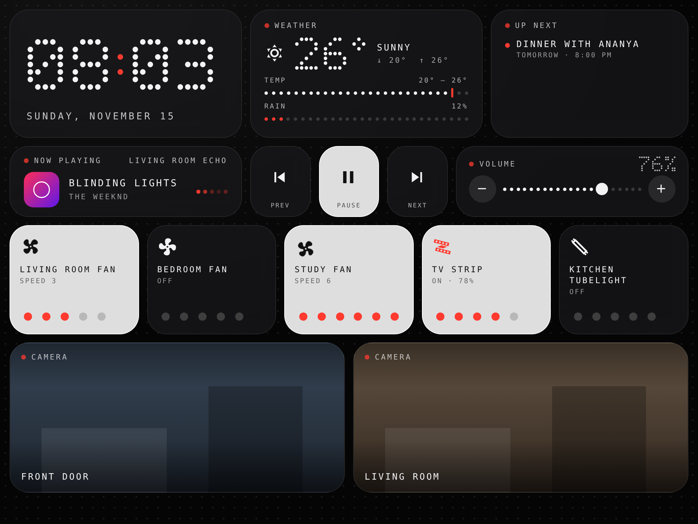

# HomeControl: HomeView iPad wall panel

This repo builds a one-screen, dot-matrix "hybrid" Home Assistant dashboard for a wall-mounted **iPad Air 2 (iPadOS 15.8)**.
Home Assistant runs on a **Mac Mini** in a UTM virtual machine.



On the screen:

- a dot-matrix clock;
- weather with temperature and rain dot bars;
- upcoming events from iCloud;
- Spotify → Echo controls;
- 3 Atomberg fans with tappable speed dots;
- a Tapo strip and a Wipro tubelight with brightness dots;
- 2 Tapo camera snapshots that open live.

It also has an idle clock screensaver and camera motion pop-ups.

**→ Setup: [docs/SETUP.md](docs/SETUP.md)**

## Files

```
homeview/config.yaml           <- the only file you edit (entity IDs, names, accent colour)
homeview/base.yaml             design system: button-card templates + kiosk / screensaver settings
homeview/dotmatrix.js          dot-matrix digit renderer injected into the templates
homeview/build_dashboard.py    generates dist/ from the files above
dist/homeview_dashboard.yaml   paste into the dashboard's Raw configuration editor
dist/homeview_package.yaml     copy to /config/packages/homeview.yaml (helpers, sensors, script, automations)
reference/                     the original HomeView blueprint and the design reference image
```

## Rebuild

```bash
pip install pyyaml
```

```bash
python3 homeview/build_dashboard.py
```

The build lists every `your_…` placeholder still to fill in, and it fails if a pop-up link has no matching pop-up.
