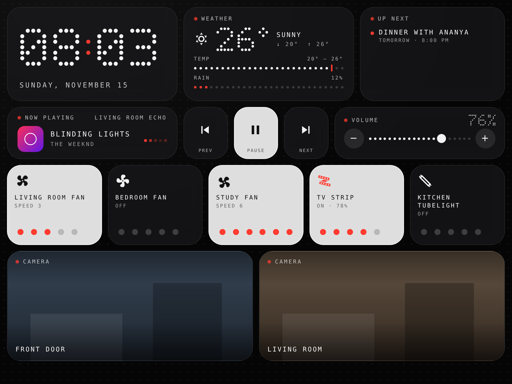

# HomeView iPad panel: setup guide

**What you'll end up with:** an iPad Air 2 on the wall showing one dark, dot-matrix screen that controls:

- 3 Atomberg fans, with speed dots
- a Tapo light strip and a Wipro tubelight, with brightness dots
- Spotify playing on your Echo
- weather, your iCloud calendar and 2 Tapo cameras

It also shows a big clock screensaver when idle, and pops up a camera live when that camera sees motion.


*Preview rendered with sample devices. Your names come from your apps.*

There are four parts. Do them in order; each one has a checkpoint.

| Part | Where | Time |
|---|---|---|
| A. Run Home Assistant on the Mac Mini | Mac | ~45 min |
| B. Add your devices to Home Assistant | Browser + phone apps | ~1 h |
| C. Install the HomeView dashboard | Browser | ~20 min |
| D. Set up the iPad | iPad | ~15 min |

---

## Part A: Home Assistant on the Mac Mini

Home Assistant OS runs inside a free virtual machine app called **UTM**. The Mac stays a normal Mac, and Home Assistant runs quietly in a window you can minimise.

> **The Mac must stay on.** When the Mac sleeps or shuts down, Home Assistant stops, and so do the panel, the fan and light controls, music and camera alerts.
> An Apple-silicon Mac Mini idling 24/7 uses only a few watts. If leaving it on doesn't work for you, a dedicated box (Home Assistant Green or a Raspberry Pi) is the later fix. Your setup moves to it with one backup file.

### A1. Download two things

1. **UTM**, from [mac.getutm.app](https://mac.getutm.app). It's free.
2. **Home Assistant OS for Apple silicon.** Go to [github.com/home-assistant/operating-system/releases](https://github.com/home-assistant/operating-system/releases). Under the newest release's *Assets*, download `haos_generic-aarch64-<version>.qcow2.xz`.
   Double-click it to unpack it into a `.qcow2` file.

### A2. Create the virtual machine

In UTM:

1. Click **+ → Virtualize → Other**. Tick **Skip ISO boot** → Continue.
2. Set **Memory to 4096 MB** and **CPU cores to 2**, then click Continue. Accept the default storage (you'll delete it in a moment) and click Continue. Skip shared directory → Continue.
3. Name it **`Home Assistant`**, tick **Open VM Settings**, and click Save.
4. In the settings that open:
   - **Network → Network Mode: Bridged (Advanced)**. Interface: **en0**. Use an Ethernet cable to the router if you can; it's much more reliable than Wi-Fi for this.
   - **Drives:** select the existing drive and **Delete** it. Then **New → Import…**, choose the `.qcow2` file, and set Interface to **VirtIO**.
   - Click **Save**.
5. Press **▶ (Start)**. After a few minutes the console shows `http://homeassistant.local:8123` and an IP address.

**Checkpoint:** on any device on your Wi-Fi, open **http://homeassistant.local:8123**. The first start can take 10–20 minutes while it downloads updates.
Create your owner account, set your **home location** (this drives the weather), and finish onboarding.

### A3. Keep it running

On the Mac:

- **System Settings → Energy:** turn on **Prevent automatic sleeping when the display is off**, **Wake for network access**, and **Start up automatically after a power failure**.
- **System Settings → Users & Groups → Automatically log in as** your user. This option only appears if FileVault is off.
- **Auto-start the VM at login:**
  1. Open **Automator → New → Application** and add **Run Shell Script** containing:

     ```bash
     sleep 20; /Applications/UTM.app/Contents/MacOS/utmctl start "Home Assistant"
     ```

  2. Save it as `Start Home Assistant.app`.
  3. Add it under **System Settings → General → Login Items**.
- **Give Home Assistant a fixed address.** In your router's admin page, find the device called `homeassistant` and set a **DHCP reservation** for its IP address. The iPad will use this address.

---

## Part B: Add your devices

Do each device and check it appears under **Settings → Devices & services**.
Fans and lights keep the names they have in their apps, and those are the names the panel shows.

### B1. HACS (community add-on store)

Some of your devices need it.

1. **Settings → Add-ons → Add-on store**, then install and start **Terminal & SSH**. Open its web UI and run:

   ```bash
   wget -O - https://get.hacs.xyz | bash -
   ```

2. Restart Home Assistant (**Settings → ⋮ → Restart**).
3. **Settings → Devices & services → Add integration → HACS**, and sign in with a GitHub account. A free account is fine.

### B2. Tapo light strip

1. **Add integration → TP-Link Smart Home**. It's often already listed as *Discovered*.
2. Enter your **Tapo account email and password**.

Checkpoint: a `light.…` entity that turns the strip on and off.

### B3. Wipro tubelight (Smart Life)

1. In the **Smart Life** app: **Me → ⚙ Settings → Account and Security → User Code**. Copy the code.
2. In HA: **Add integration → Tuya**. Enter the user code, then scan the QR code it shows with the Smart Life app.

Checkpoint: a `light.…` entity for the tubelight.

### B4. Atomberg fans

There's no official Atomberg integration. The established community one uses Atomberg's official developer API.

1. In the **Atomberg Home** app, open **Developer options**, enable it, and note the **API key** and **refresh token**.
2. Go to **HACS → ⋮ → Custom repositories**. Add `https://github.com/dasshubham762/atomberg-integration` with type **Integration**, install **Atomberg**, and restart HA.
3. **Add integration → Atomberg**, and paste the API key and refresh token.

Checkpoint: three `fan.…` entities. The panel reads how many speeds each fan has and draws that many dots.

### B5. Tapo cameras

1. **Tapo app:**
   - For each camera: **⚙ → Advanced settings → Camera account**. Create a username and password.
   - Then **Me → Tapo Lab → Third-Party Compatibility → On**. Newer firmware needs this.
2. Install the **Tapo: Cameras Control** integration:
   - Go to **HACS** and search for "Tapo: Cameras Control". It's listed by default. Install it and restart HA.
   - Then **Add integration → Tapo: Cameras Control**, once per camera. Enter the camera's IP address, the camera-account login, and your Tapo cloud password.

Checkpoint: for each camera there's `camera.<name>_hd_stream`, `camera.<name>_sd_stream` and a motion sensor. Some models also have a person-detection sensor; if yours do, use it for alerts.

### B6. Spotify → Echo

1. **Echo side:**
   - In the **Alexa app**, link Spotify under **Settings → Music & Podcasts** and set it as default.
   - Say "**Alexa, play Spotify**" once so the Echo registers as a Spotify Connect speaker.
   - Then open the Spotify app on your phone, tap the devices icon, and note the Echo's name **exactly as shown**.
2. **Spotify app credentials:**
   - Go to [developer.spotify.com/dashboard](https://developer.spotify.com/dashboard) → **Create app**.
   - Any name works. Set the Redirect URI to `https://my.home-assistant.io/redirect/oauth` and tick **Web API**.
   - Copy the **Client ID** and **Client secret**.
3. In HA: **Add integration → Spotify**, paste the Client ID and secret, and log in.

Checkpoint: `media_player.spotify_<you>`.

### B7. iCloud calendar

1. On [account.apple.com](https://account.apple.com), go to **Sign-In and Security → App-Specific Passwords** and create one called "Home Assistant".
2. In HA: **Add integration → CalDAV**:
   - URL: `https://caldav.icloud.com`
   - Username: your Apple ID email
   - Password: the app-specific password

Checkpoint: one `calendar.…` entity per iCloud calendar.

### B8. Weather

Nothing to do. `weather.forecast_home` (Met.no) was created during onboarding from your home location.

---

## Part C: Install the dashboard

### C1. Frontend plugins (HACS)

In **HACS**, search for and install each of these:

- **button-card**
- **Bubble Card**
- **WallPanel**
- **Kiosk Mode**

Then refresh the browser.

### C2. Tell me your entity IDs and I'll generate everything

In HA, go to **Developer tools → Template**, paste this, and send me the output:

```jinja

{{ s.entity_id }} | {{ s.name }}

```

Also send the Echo name from B6. I'll fill in [`homeview/config.yaml`](../homeview/config.yaml) and rebuild `dist/`.

(If you'd rather do it yourself: replace every `your_…` value in that file and run `python3 homeview/build_dashboard.py`. It lists anything you missed.)

### C3. Install the HomeView package

The package contains the helpers, the clock and weather sensors, the music script and the camera-alert automations.

1. **Add-on store → File editor** → install, start, and turn on *Show in sidebar*.
2. In File editor, open **`configuration.yaml`** and add these lines at the end (or merge them if a `homeassistant:` section already exists):

   ```yaml
   homeassistant:
     packages: !include_dir_named packages
   ```

3. Create the folder **`packages`**. Inside it, create **`homeview.yaml`** with the contents of [`dist/homeview_package.yaml`](../dist/homeview_package.yaml).
4. **Developer tools → YAML → Check configuration** should say it's valid. Then **Restart**.

Checkpoint: `sensor.homeview_minute`, `sensor.homeview_weather_today` and `script.homeview_play_pause` exist.

### C4. Create the dashboard

1. **Settings → Dashboards → Add dashboard → New dashboard from scratch.** Set the title to `HomeView` and the URL to **`homeview`**.
2. Open it, then go to **✏ → ⋮ → Raw configuration editor**.
3. Select all, paste [`dist/homeview_dashboard.yaml`](../dist/homeview_dashboard.yaml), and click **Save**.

### C5. A user for the iPad

**Settings → People → Add person** "iPad Panel". Turn on *Allow login* and leave **Administrator off**. Kiosk mode hides the header and sidebar for this user.

---

## Part D: The iPad (Air 2, iPadOS 15.8)

1. **Settings → General → Software Update:** install the newest 15.8.x.
2. Install the **Home Assistant** app. The App Store offers **2026.7.1** as the *last compatible version*; it's the newest that runs on iPadOS 15.
   Connect it to `http://<the reserved IP>:8123` and log in as **iPad Panel**.
3. In the app, open the **profile** (bottom of the sidebar). Set **Dashboard → HomeView** and **Theme → Dark**.
4. **Settings → Display & Brightness → Auto-Lock → Never.** Also turn on an always-on **Do Not Disturb** Focus.
5. **Settings → Accessibility → Guided Access → On** and set a passcode. Then open the HA app and **triple-click the Home button → Start**.
6. Rotate the iPad to landscape and turn on **rotation lock** in Control Center.

If something looks stale after an update, open the HA app's settings and go to **Companion App → Debugging → Reset frontend cache**.

**Keep the iPad working:** before updating Home Assistant, read the release notes' *Breaking changes* for "Safari" or "iOS". HA currently supports Safari/iOS 15.4 and newer. A future increase above iOS 15 would retire this iPad as a panel.

---

## Using the panel

| Do this | What happens |
|---|---|
| Tap a fan or light | Toggles it. The tile turns bright when on. |
| Tap a dot under a fan or light | Sets the speed (fans) or brightness in 20 % steps (lights) |
| Hold a fan or light | Opens HA's detail dialog: colour for the strip, plus the fan's extra modes |
| ▶ / ❚❚ | Plays Spotify on the Echo, moving playback there if needed, or pauses it |
| Tap *Now playing* | Spotify details, including switching speaker |
| − / + | Echo volume |
| Tap weather or *Up next* | Hourly/daily forecast, or this week's calendar |
| Tap a camera | Live HD view with a *Next camera* button. Tap outside to close. |
| Hold the clock | Shows or hides the HA header (admin logins only) |
| Leave it alone for 2 min | Big dot-matrix clock screensaver. Tap to wake. |
| Camera sees motion | The iPad wakes and shows that camera live for 30 s |

**Change things later:** edit `homeview/config.yaml` and rebuild, or just tell me what to change.
For example: names (`name:`), the accent colour, whether blur is on (`glass_blur: false` if the iPad feels slow), or turning camera alerts off (delete `alert_sensor:`).

## Troubleshooting

| Symptom | Fix |
|---|---|
| `homeassistant.local` won't open | Check that the UTM window shows the VM running. Use the IP shown in its console. Check the network is set to *Bridged*. |
| Panel shows "Custom element doesn't exist" | A HACS plugin is missing (C1). Reinstall it, then reset the iPad app's frontend cache. |
| Play does nothing | The Echo isn't listed in Spotify Connect. Say "Alexa, play Spotify" once, then retry. The `speaker:` name in `config.yaml` must match Spotify's device list exactly. |
| Camera tiles are black | Turn on Third-Party Compatibility in the Tapo app, and check that the camera account login is correct. |
| Camera alerts fire too often | Point `alert_sensor` at a person-detection sensor if your camera has one, or delete it to turn alerts off. |
| Clock frozen / weather empty | The package isn't loaded (C3). Check that `sensor.homeview_minute` exists. |

## How this was checked

- The generator checks that every pop-up link has a matching pop-up.
- All JavaScript in the dashboard ran in a small button-card emulator with sample devices (playing, idle, offline). The preview above comes from that emulator.
- The package's Jinja templates were rendered with real Jinja.

It has **not** run on a live Home Assistant yet. A few options come from plugin documentation rather than a live test:

- Bubble Card `trigger`, `width_desktop` and `bg_*`;
- WallPanel `screensaver_entity`;
- the fan icon reusing button-card's built-in `rotating` animation.

If anything renders differently, send me a screenshot.
